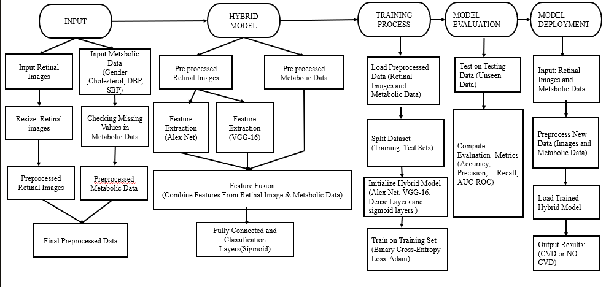
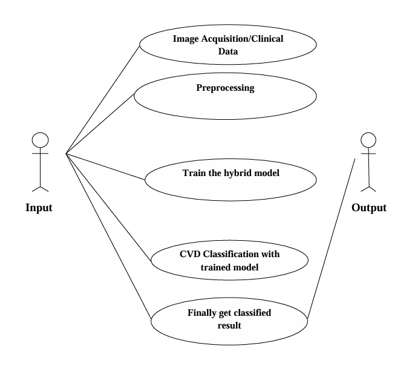
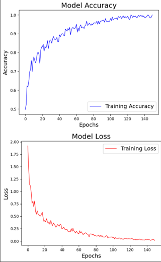
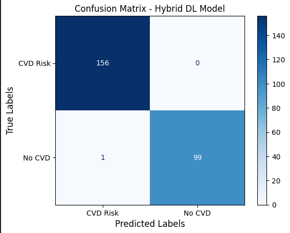
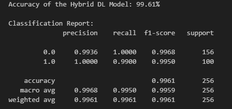
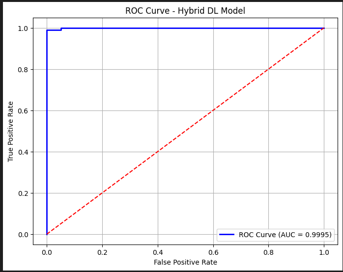
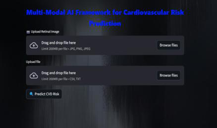
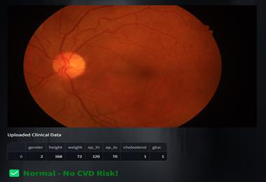
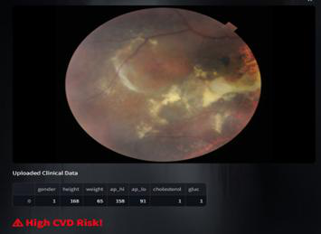

# Multi-Modal AI Framework for Cardiovascular Risk Prediction

## Overview

A multimodal deep learning framework for cardiovascular disease risk prediction that combines **retinal fundus images** with **clinical health parameters**. The system uses **VGG16 and AlexNet** for visual feature extraction and combines the extracted image features with clinical data to perform cardiovascular risk prediction.

## Key Features

- Retinal fundus image analysis
- Clinical data integration
- VGG16 and AlexNet-based feature extraction
- Multimodal feature fusion
- Cardiovascular risk prediction
- Streamlit-based web application

## Technologies Used

- Python
- TensorFlow / Keras
- VGG16
- AlexNet
- NumPy
- Pandas
- Scikit-learn
- Streamlit
- OpenCV

## Project Workflow

```text
Retinal Fundus Image
        ↓
Image Preprocessing
        ↓
VGG16 + AlexNet
        ↓
Visual Feature Extraction
        ↓
Feature Fusion ← Clinical Data
        ↓
Hybrid Prediction Model
        ↓
Cardiovascular Risk Prediction
```

## Application

The trained framework is integrated into a Streamlit web application where users can provide retinal fundus images along with relevant clinical parameters to obtain a cardiovascular risk prediction.

## Project Structure

```text
├── Final.py
├── README.md
├── requirements.txt
├── report/
├── publication/
└── screenshots/
```

## Academic Project

This project was developed as a B.Tech research project at **SRM Institute of Science and Technology**.

## Author

**Devaj B R**  
B.Tech Artificial Intelligence

## Project Architecture



## System Design



## Model Training Results

### Training Accuracy & Loss



### Confusion Matrix



### Classification Report



### ROC Curve



## Application

### Streamlit Interface



### Normal Risk Prediction



### High Cardiovascular Risk Prediction



## Project Resources

- 📘 [Project Report](report/B.Tech-Research-Project.pdf)
- 📄 [Research Publication](publication/ICONDEEPCOM_094.pdf)
- 🏆 [Project Certificate](certificate/certificate.pdf)
- 💻 [Source Code / Jupyter Notebook](Final.ipynb)
